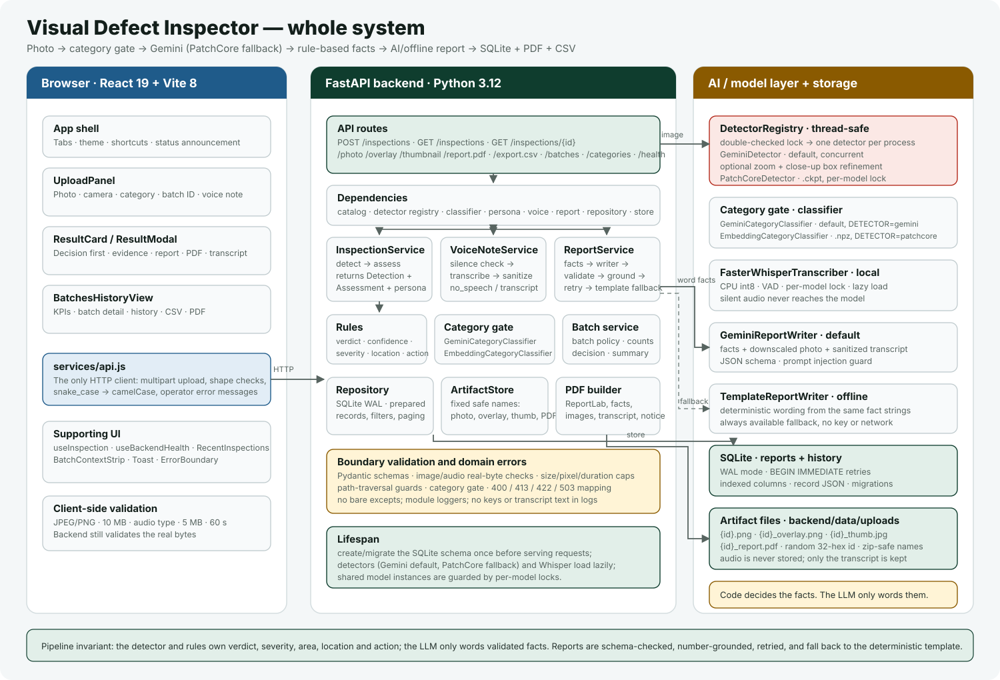

# Visual Defect Inspector

A software-only **factory QC operator** MVP: upload a photo of a manufactured
item, get a pass/defect decision with evidence and a recommended action, keep an
inspection history, add an optional voice note, and download an AI-written PDF
report.

Built with **FastAPI + Python 3.12**, **React 19 + Vite 8**, **Anomalib
PatchCore** (local vision), **faster-whisper** (local speech), **Gemini**
(report wording, optional) and **SQLite**.

> **Core principle:** the detector and rules own the facts (verdict,
> confidence, severity, area, location, action). The LLM only words validated
> facts. A deterministic template is always available if the LLM fails.

## Table of contents

- [Features](#features)
- [Quick start with Docker](#quick-start-with-docker)
- [Local development](#local-development)
- [Architecture](#architecture)
- [Request flow](#request-flow)
- [API](#api)
- [AI pipeline](#ai-pipeline)
- [Repository layout](#repository-layout)
- [Configuration](#configuration)
- [Testing](#testing)
- [Benchmarks](#benchmarks)
- [Sample data and reports](#sample-data-and-reports)
- [Security](#security)
- [Limitations](#limitations)
- [Documentation](#documentation)
- [Attribution](#attribution)

## Features

| SOW requirement                     | Implementation                                                                    |
| ----------------------------------- | --------------------------------------------------------------------------------- |
| Photo upload or browser camera      | `UploadPanel` file picker, drag-and-drop and `capture="environment"` camera input |
| Pass/defect verdict with confidence | PatchCore score + persona cutoff + `rules.compute_confidence`                     |
| Defect location                     | Binary mask → 3×3 grid cell + normalized bounding box + red overlay               |
| Defect type and severity            | Severity from flagged area; defect type is an AI estimate from the photo          |
| Recommended action                  | Persona action table: accept / rework / reject / re-inspect                       |
| Inspection history                  | SQLite + history table with thumbnails, verdict, date, filters and pagination     |
| Optional voice note                 | Browser recording or audio upload → local faster-whisper → sanitized transcript   |
| PDF inspection report               | ReportLab report with facts, photos, transcript, review banner and AI wording     |
| Batch decision + CSV                | Batch policy over inspections + CSV defect log export                             |
| Multi-category                      | Bottle, metal nut and screw configs; lazy detector per category                   |
| Local models                        | PatchCore and faster-whisper run locally; Gemini is optional                      |

## Quick start with Docker

Prerequisites: Docker Desktop (or Docker Engine + Compose).

```bash
# 1. Create the runtime environment file.
cp backend/.env.example backend/.env

# 2a. Use Gemini for report wording: edit backend/.env with a real key.
#     GEMINI_API_KEY=...
#     GEMINI_MODEL=gemini-2.5-flash
#     REPORT_WRITER=gemini

# 2b. OR use the offline template writer, no key needed:
#     REPORT_WRITER=template

# 3. The detector checkpoints must exist on the host first.
#    See docs/MODELS.md for Git LFS / release / training options.

# 4. Build and start both containers.
docker compose up --build

# 5. Open the app.
open http://localhost:5173
```

Services:

| Service  | URL                            | Notes                                                  |
| -------- | ------------------------------ | ------------------------------------------------------ |
| Frontend | <http://localhost:5173>        | nginx serves the built React app and proxies API paths |
| Backend  | <http://localhost:8000>        | FastAPI; also reachable directly                       |
| Health   | <http://localhost:8000/health> | should return `{"status":"ok"}`                        |

Useful Docker commands:

```bash
docker compose up --build -d          # start in the background
docker compose ps                     # show health/status
docker compose logs -f backend        # follow backend logs
docker compose logs -f frontend       # follow nginx logs
docker compose down                   # stop and remove containers
```

The first voice request downloads the Whisper model. The cache is persisted in
`backend/data/models-cache` through `HF_HOME` in `compose.yaml`.

> **Model warning:** the trained checkpoints are ~108–120 MB each and are not in
> the normal Git history. Without them the category catalog is empty. Read
> [`docs/MODELS.md`](docs/MODELS.md) before running on a fresh clone. For the
> complete three-category demo, publish the full ~301 MB model bundle as a
> GitHub Release; the bottle-only zip (~108 MB) is only a smaller fallback.

### Fresh clone with all three categories

The full model bundle is a **~301 MB GitHub Release asset** (about 330 MB
unpacked). After cloning:

```bash
git clone <repo-url>
cd defect-inspector

# Download the release asset, then unpack it into backend/results.
unzip ~/Downloads/defect-inspector-models.zip -d backend/results

cp backend/.env.example backend/.env
# edit .env: GEMINI key + model, or REPORT_WRITER=template

docker compose up --build
open http://localhost:5173
```

`GET /categories` then returns bottle, metal nut and screw. The first Docker
build dominates the 10-minute budget. The optional first voice request downloads
the Whisper model (~404 MB), so keep that out of the first-run timing.

If no release asset is available, see [`docs/MODELS.md`](docs/MODELS.md) for
Git LFS, release-bundle and retraining options.

## Local development

Two terminals, from the repo root.

**Backend**

```bash
cd backend
cp .env.example .env        # if .env does not exist
uv sync
uv run uvicorn app.main:app --reload
```

**Frontend**

```bash
cd frontend
npm install
npm run dev
```

Open <http://localhost:5173>. Vite proxies `/inspections`, `/batches`,
`/categories` and `/health` to `http://127.0.0.1:8000`, so the browser uses one
origin and no CORS setup is needed.

The first inspection loads the PatchCore checkpoint (about 3–5 seconds on the
M1 Air); later inspections are much faster.

## Architecture



The full architecture, component responsibilities, sequence diagram and
deployment view are in [`docs/ARCHITECTURE.md`](docs/ARCHITECTURE.md).

Layers:

```
Browser (React)
  → services/api.js
    → FastAPI routes
      → services (inspection, rules, report, voice, batch)
        → models (PatchCore, embedding gate, Whisper, Gemini/template)
      → repository (SQLite) + artifact store + PDF builder
```

## Request flow

`POST /inspections` is multipart: `image` (required), `category` (required),
`batch_id` (optional) and `voice_note` (optional).

1. Validate the real image bytes, byte/pixel limits and category id.
2. Validate and decode the optional audio; enforce 5 MB and 60 s.
3. Run the category gate (embedding similarity vs the category prototype).
4. Transcribe the voice note if present; a silent note returns `no_speech` and
   never loads the model.
5. Run the category's PatchCore detector.
6. Apply the persona rules: verdict, confidence, severity, area, location,
   action and `needs_review`.
7. Build report facts, word them with Gemini or the template writer, validate
   the draft, check numbers, retry and fall back.
8. Save the photo, overlay, thumbnail, record and transcript; generate and store
   the PDF; compute the batch decision.
9. Return the facts, report, voice result, batch info and image URLs.

## API

| Method | Path                           | Purpose                                                 |
| ------ | ------------------------------ | ------------------------------------------------------- |
| `GET`  | `/health`                      | Liveness                                                |
| `GET`  | `/categories`                  | Available categories and defect labels                  |
| `POST` | `/inspections`                 | Create one inspection                                   |
| `GET`  | `/inspections`                 | History, with `limit`, `offset`, `batch_id`, `category` |
| `GET`  | `/inspections/{id}`            | Stored inspection detail                                |
| `GET`  | `/inspections/{id}/photo`      | Original PNG                                            |
| `GET`  | `/inspections/{id}/overlay`    | Annotated PNG                                           |
| `GET`  | `/inspections/{id}/thumbnail`  | JPEG thumbnail                                          |
| `GET`  | `/inspections/{id}/report.pdf` | Generated PDF                                           |
| `GET`  | `/inspections/export.csv`      | Defect log CSV                                          |
| `GET`  | `/batches`                     | Batch summaries                                         |
| `GET`  | `/batches/{batch_id}`          | Batch summary and its items                             |

Errors: `400` invalid image/audio, `413` too large/too long, `422` validation or
category mismatch, `404` unknown inspection/batch, `503` detector, transcriber
or storage unavailable.

OpenAPI docs are available at <http://localhost:8000/docs> when the backend is
running.

## AI pipeline

1. **Category gate** — `wide_resnet50_2.racm_in1k` timm embedding, compared by
   cosine similarity to a per-category prototype with `min_similarity`.
2. **Anomaly detection** — local PatchCore checkpoint per category returns a
   score, an anomaly map and a binary mask.
3. **Rules** — area ratio, severity bands, cutoff/review margin, 3×3 location,
   action table.
4. **Report facts** — a code-built `ReportFacts` object with preformatted
   strings (`93.7%`, `17.5%`, `0.937`). The writer may only use these strings.
5. **Wording** — Gemini receives the facts, an optional downscaled photo and a
   sanitized transcript. The response is constrained to a JSON draft schema.
6. **Validation** — strict Pydantic content limits, defect-type rules, and a
   number-grounding check; one retry; then the deterministic template.
7. **Speech** — local faster-whisper, VAD, int8 CPU; transcript is normalized,
   capped and wrapped as untrusted data in the prompt.
8. **PDF** — ReportLab renders the stored record: header, verdict banner, facts,
   original + annotated photos, review notice, transcript and AI/template note.

## Repository layout

```
defect-inspector/
├── backend/                 FastAPI service, models, tests, configs, scripts
├── frontend/                React + Vite app, tests, nginx/Dockerfile
├── samples/                 sample images, audio and generated PDFs
├── docs/                    architecture, project guide, test cases, models
├── compose.yaml             backend + frontend Docker stack
├── .env.example             backend example at backend/.env.example
└── README.md
```

## Configuration

Copy `backend/.env.example` to `backend/.env`. Important values:

| Variable               | Default               | Purpose                          |
| ---------------------- | --------------------- | -------------------------------- |
| `REPORT_WRITER`        | `gemini`              | `gemini` or `template`           |
| `GEMINI_API_KEY`       | —                     | Required only for `gemini`       |
| `GEMINI_MODEL`         | —                     | Required only for `gemini`       |
| `PERSONA_NAME`         | `factory_qc_operator` | Persona config                   |
| `DETECTOR_DEVICE`      | `auto`                | `auto`, `mps`, `cuda`, `cpu`     |
| `ENABLED_CATEGORIES`   | empty                 | Limit served category ids        |
| `WHISPER_MODEL`        | `base`                | faster-whisper model             |
| `WHISPER_DEVICE`       | `cpu`                 | Whisper device                   |
| `WHISPER_COMPUTE_TYPE` | `int8`                | Whisper precision                |
| `MAX_AUDIO_BYTES`      | `5242880`             | Voice note byte cap              |
| `MAX_AUDIO_SECONDS`    | `60`                  | Voice note duration cap          |
| `MAX_TRANSCRIPT_CHARS` | `1000`                | Transcript cap before the prompt |

The Gemini key and model are optional when `REPORT_WRITER=template`.

## Testing

Backend, from `backend/`:

```bash
uv run ruff format --check .
uv run ruff check .
uv run pyright
uv run pytest
uv run pytest --cov=app --cov-report=term-missing
```

Frontend, from `frontend/`:

```bash
npm run format:check
npm run lint
npm run test
npm run test:coverage
npm run build
```

Current results:

| Suite       | Result                                                |
| ----------- | ----------------------------------------------------- |
| Backend     | **255 passed**, **87% coverage**                      |
| Frontend    | **148 passed**, **93.8% statements / 85.7% branches** |
| Lint/format | Ruff, Prettier and ESLint pass                        |
| Types       | Pyright: 0 errors                                     |

The tests mock every AI model, so they are deterministic and never call Gemini.
The full test-case inventory is in [`docs/TEST_CASES.md`](docs/TEST_CASES.md).

## Benchmarks

Measured on an **M1 MacBook Air** with the bottle PatchCore checkpoint:

| Measurement                   | Result                                         |
| ----------------------------- | ---------------------------------------------- |
| PatchCore warm inference, MPS | **51 ms** average (5 runs)                     |
| PatchCore warm inference, CPU | **90 ms** average (5 runs)                     |
| Model load time               | **4.6 s** MPS / **2.7 s** CPU                  |
| Score consistency             | `0.936946` MPS vs `0.936947` CPU               |
| Bottle checkpoint size        | **108 MB**                                     |
| Screw checkpoint size         | **114 MB**                                     |
| Prototype size                | **20 KB** per category                         |
| Coreset 1% training           | about **2 minutes** per category               |
| Coreset 10% training          | about **22 minutes** per category              |
| Local Whisper                 | faster-whisper, CPU int8, VAD enabled          |
| Whisper `base` cache          | about **404 MB** after the first voice request |

Docker runs on Linux CPU, so use the CPU inference number as the container
expectation. The first request after container start also pays the model-load
cost.

## Sample data and reports

[`samples/`](samples/) contains:

- six MVTec AD test images across bottle, screw and metal nut
- a short WAV voice note
- four generated PDF reports: pass, high-severity defect with voice note,
  low-confidence review, and medium contamination

See [`samples/README.md`](samples/README.md) for usage and attribution.
Regenerate the PDFs with:

```bash
cd backend
uv run python -m scripts.build_sample_reports
```

## Security

- No secrets in Git; `.env` is ignored and `.env.example` is committed.
- Real-byte image/audio validation, byte/pixel/duration caps and SVG/PDF rejection.
- Pydantic validation at every boundary; category/persona configs validated at startup.
- Path-traversal guards on inspection ids and fixed artifact names.
- Parameterized SQLite queries only; no `eval` or `pickle` on user data.
- Transcripts are untrusted: control characters, angle brackets and invisible
  characters are removed, length is capped, and the prompt fences the text and
  tells the model never to follow instructions inside it.
- LLM output is untrusted: strict schema, allowed defect types, number grounding,
  retry and template fallback.
- Logs contain sizes and durations, never transcripts or keys.

## Limitations

- **Out-of-scope / OOD detection is not implemented.** PatchCore has no object
  classifier, so a random object may be scored as a defect rather than rejected
  as an unsupported image.
- The defect **type** is an AI estimate; the detector only says where and how
  much. A defect report may legitimately have `defect_type: null`.
- Severity bands and cutoffs are a starting policy calibrated from a small
  sample, not a production calibration.
- The Gemini free tier may use submitted content to improve Google products; do
  not send private photos.
- One model per process is shared by all requests; this is demo-scale.
- The report writer is Gemini by default. Fully local report wording would
  require a local LLM/Ollama writer; the template path is offline but not
  generative.

## Documentation

- [Complete project guide](docs/PROJECT_GUIDE.md) — study and revision guide
- [Architecture](docs/ARCHITECTURE.md) — diagrams and component responsibilities
- [Every test case](docs/TEST_CASES.md) — backend and frontend inventories
- [File index](docs/FILE_INDEX.md) — one line per file
- [Model distribution](docs/MODELS.md) — checkpoints, LFS, releases
- [Sample assets](samples/README.md) — images, audio, PDFs and attribution

## Attribution

- **MVTec AD** dataset, © MVTec Software GmbH, CC BY-NC-SA 4.0:
  <https://www.mvtec.com/company/research/datasets/mvtec-ad>
- **Anomalib / PatchCore**, Intel OpenVINO ecosystem.
- **faster-whisper**, SYSTRAN.
- **timm** pretrained `wide_resnet50_2.racm_in1k` backbone.
- **Gemini API**, Google (optional; only report wording).
- **ReportLab**, **FastAPI**, **React**, **Vite**.
