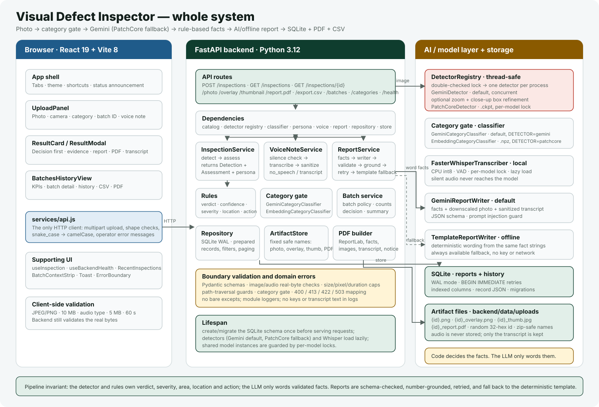
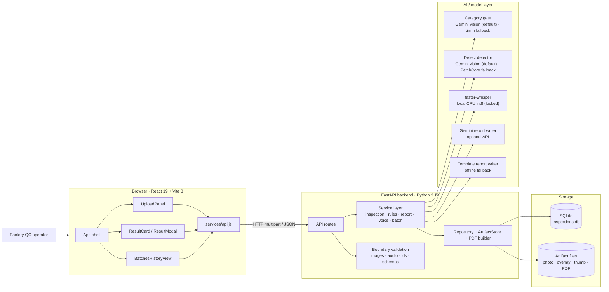
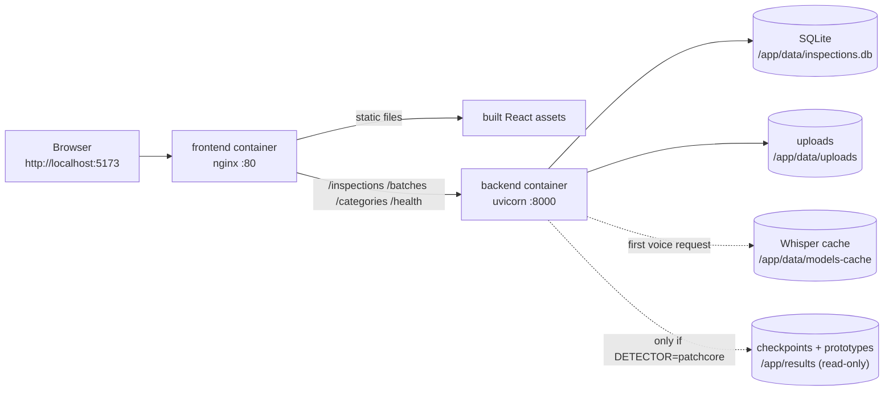

# Architecture



The diagram above is the version to show in a demo. This file explains the same
system in text and in Mermaid, so it also renders on GitHub.

## 1. System context



## 2. Components and responsibilities

| Layer    | Component                                                                  | Responsibility                                                                                |
| -------- | -------------------------------------------------------------------------- | --------------------------------------------------------------------------------------------- |
| UI       | `frontend/src/App.jsx`                                                     | Tabs, theme, keyboard shortcuts, categories, batch context, recent inspections, history modal |
| UI       | `UploadPanel`                                                              | Photo/camera upload, category, batch id, voice note record/upload, client validation          |
| UI       | `ResultCard`                                                               | Decision-first result, evidence, facts, report, transcript, PDF download                      |
| UI       | `BatchesHistoryView`                                                       | KPIs, batch table, inline batch detail, history table, filters, CSV, pagination               |
| UI       | `services/api.js`                                                          | The only HTTP client; response shape validation and camelCase mapping                         |
| API      | `app/api/*.py`                                                             | Thin HTTP routes; no model or SQL logic inline                                                |
| API      | `app/api/dependencies.py`                                                  | Dependency injection and process-level caches                                                 |
| Boundary | `core/images.py`, `core/audio.py`, `core/categories.py`, `core/persona.py` | Validate real bytes, sizes, durations, ids, category and persona configs                      |
| Service  | `InspectionService`                                                        | Run one photo through the category detector and rules                                         |
| Service  | `CategoryVerifier`                                                         | Yes/no gate: does this photo look like the chosen category?                                   |
| Service  | `VoiceNoteService`                                                         | Silence check, transcription, transcript cleaning                                             |
| Service  | `ReportService`                                                            | Facts → writer → schema validation → number grounding → retry → template fallback             |
| Service  | `Batch service`                                                            | Batch decision policy and aggregate counts                                                    |
| Service  | `Repository`                                                               | Parameterized SQLite persistence and history queries                                          |
| Service  | `ArtifactStore`                                                            | Safe fixed file names for photos, overlays, thumbnails and PDFs                               |
| Service  | `PDF builder`                                                              | ReportLab layout from a stored record                                                         |
| Model | `GeminiDetector`              | Concurrent Gemini vision inspection with optional zoom & close-up box refinement |
| Model | `GeminiCategoryClassifier`    | Concurrent Gemini category check (ignores real-world background/lighting)        |
| Model    | `PatchCoreDetector`                                                        | Local Optional local Anomalib PatchCore inference: score, anomaly map, mask (per-model lock)                                  |
| Model    | `EmbeddingCategoryClassifier`                                              | Local Optional local timm embedding similarity to a `.npz` prototype (per-model lock) prototype                                       |
| Model    | `FasterWhisperTranscriber`                                                 | Local speech-to-text                                                                          |
| Model    | `GeminiReportWriter`                                                       | AI wording from facts, optional photo and sanitized transcript                                |
| Model    | `TemplateReportWriter`                                                     | Deterministic offline wording and fallback                                                    |
| Data     | SQLite                                                                     | One row per inspection with indexed columns and the full record JSON                          |
| Data     | Upload folder                                                              | Photo, annotated overlay, thumbnail, PDF; audio is never stored                               |

## 3. Request flow: `POST /inspections`

```mermaid
sequenceDiagram
  autonumber
  participant O as Operator
  participant UI as React UI
  participant API as FastAPI
  participant Gate as Category gate
  participant Voice as Whisper
  participant Det as Detector (Gemini/PatchCore)
  participant Rules
  participant Rep as ReportService
  participant DB as SQLite + files
  participant PDF as PDF builder

  O->>UI: photo + category + optional batch + optional voice note
  UI->>API: multipart POST /inspections
  API->>API: validate photo bytes, limits, audio bytes, duration, ids
  API->>Gate: verify part (Gemini or embedding similarity)
  Gate-->>API: pass / category mismatch (422)
  opt voice note present
    API->>Voice: decode, silence check, transcribe
    Voice-->>API: cleaned transcript or no_speech
  end
  API->>Det: detect(photo)
  Det-->>API: score, anomaly map, binary mask
  API->>Rules: assess(score, mask, effective persona)
  Rules-->>API: verdict, confidence, severity, area, action, location
  API->>Rep: facts + transcript
  Rep->>Rep: schema + defect type + number grounding; retry; template fallback
  Rep-->>API: validated report
  API->>DB: save photo, overlay, thumbnail, record JSON, transcript
  API->>PDF: render report from the stored record
  API->>DB: save PDF and report path
  API-->>UI: 201 with facts, report, voice_note, batch decision and image URLs
  UI-->>O: decision-first result, evidence, report, PDF button
```

### Failure order matters

The route validates and transcribes **before** writing any artifact. A bad
image, bad audio, category mismatch or speech-model failure therefore leaves no
orphaned photo, database row or PDF behind.

## 4. Deployment view



`docker compose up --build` starts both containers. The frontend nginx config
proxies the API paths to the backend service, so the browser uses one origin and
no CORS configuration is needed.

## 5. Data ownership

| Data                                                  | Owner                             | Where                                    |
| ----------------------------------------------------- | --------------------------------- | ---------------------------------------- |
| Verdict, confidence, severity, area, location, action | `services/rules.py`               | `Assessment` in the record               |
| Defect type                                           | AI estimate (Gemini) or `null`    | `report.content.defect_type`             |
| Report wording                                        | Gemini or template writer         | `report.content`                         |
| Manual review flag                                    | Code (`ReportService`)            | `report.manual_review_notice`            |
| Batch decision                                        | Code (`services/batch.py`)        | Computed at read time and stored in PDFs |
| Transcript                                            | Whisper output, sanitized by code | `record.voice_note`                      |
| Original and annotated images                         | `ArtifactStore`                   | `data/uploads/{id}*.png/jpg`             |
| History and report JSON                               | Repository                        | SQLite `record_json`                     |

The core invariant: **code decides facts; AI only words them**. The report
prompt, schema validation and number-grounding check enforce that invariant.

## 6. Why this shape

- **Strategy/interface pattern** for detector, transcriber and report writer:
  local vs API models can be swapped in the factory without touching routes.
- **Repository pattern**: SQLite stays behind one protocol; routes never build
  SQL and tests can use a temp database.
- **Dependency injection**: FastAPI `Depends()` keeps routes thin and lets tests
  substitute deterministic fakes for every model.
- **Lazy model loading**: `/health` and most tests never import Torch or Whisper.
- **Graceful fallback**: the inspection never fails because the LLM failed; a
  deterministic template is always available.
- **Boundary validation**: Pydantic plus real-byte checks protect every entry
  point, and all ids/paths are validated before touching the filesystem.
- **Concurrency safety**: runs in a single Uvicorn worker; Gemini calls execute concurrently across threads while local PyTorch/Whisper models serialize inference per instance, lazy singletons use double-checked locking (`RLock`/`Lock`), and SQLite uses WAL mode with `BEGIN IMMEDIATE` retries.
